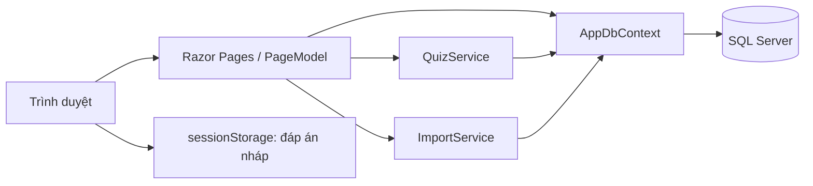
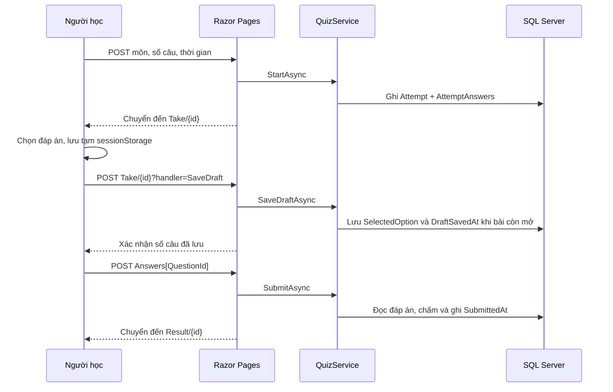

# Phân tích hoạt động Renshuu

Phân tích dựa trên repository `hung2101-fushiguro/Renshuu`, commit gốc `d1635b1`. Bản nâng cấp nằm trên nhánh `codex/clean-learning-experience`.

## 1. Kiến trúc và khởi động

Ứng dụng là một khối ASP.NET Core 8 Razor Pages. Không có SPA, API frontend riêng hay bước build npm. Razor xử lý HTML trên máy chủ; JavaScript bổ sung đồng hồ, lưu lựa chọn, bộ lọc và chuyển động.

`Program.cs` đăng ký Razor Pages, cache bộ nhớ, Session, QuizService, ImportService, TimeProvider và DbContext. Session hết hạn sau 30 phút, được dùng làm nơi lưu TempData cho bản xem trước nhập liệu. Middleware chạy theo thứ tự xử lý lỗi → status code → static files → routing → session → Razor Pages.

Trong Development, ứng dụng chạy migration trước khi nhận request. Nếu có migration chờ áp dụng, gọi DbSeeder; Seeder kiểm tra dữ liệu trước khi thêm mẫu. Kết nối SQL không thành công sẽ làm khởi động thất bại. Production hiện không tự migrate; cần áp dụng migration trong quy trình triển khai.

## 2. Mô hình dữ liệu

| Entity | Vai trò và quan hệ |
| --- | --- |
| SubjectFolder | Gom nhiều Subject. Xóa thư mục đặt FolderId của môn về null. |
| Subject | Môn học, chứa câu hỏi, bài đọc và bài làm. |
| ReadingPassage | Nội dung đọc dùng chung cho nhiều câu, thuộc một môn. |
| Question | Nội dung, bốn lựa chọn, đáp án A–D, giải thích và kiểu nhãn ABCD/1234; có thể thuộc bài đọc. |
| Attempt | Một lượt làm bài: môn, thời điểm bắt đầu/nộp/lưu nháp, giới hạn thời gian, tổng câu, số đúng. |
| AttemptAnswer | Liên kết bài làm với câu hỏi, lựa chọn của người học và trạng thái đúng/sai. |

`AttemptAnswer` bị xóa theo Attempt. Quan hệ Question → AttemptAnswer và Subject → Attempt hạn chế xóa để bảo vệ tham chiếu lịch sử. Câu hỏi không được chụp thành phiên bản độc lập khi tạo bài làm: sửa nội dung/đáp án gốc có thể làm phần xem lại khác với thời điểm làm bài.

## 3. Chọn môn và tạo bài

`Pages/Index` gọi `GetSubjectSummariesAsync`: lấy môn, số câu, thư mục và số câu còn sai. Trang mới bổ sung tổng số bài đã nộp, tỷ lệ đúng có trọng số theo số câu và ba kết quả gần nhất. Đây đều là dữ liệu thực; chưa có bài thì tỷ lệ hiển thị dấu gạch.

Người học chọn môn, số câu 1–200 và thời gian 1–240 phút hoặc để trống. POST được kiểm tra DataAnnotations và `QuizService.StartAsync`. Service kiểm tra môn tồn tại, có câu hỏi, rồi nhóm câu theo PassageId; câu độc lập là một nhóm riêng. Nhóm được xáo trộn và lấy đến khi đủ số câu yêu cầu. Vì giữ trọn nhóm bài đọc, tổng số thực tế có thể lớn hơn số yêu cầu. Tổng số thực tế không vượt 200. Nhóm không vừa giới hạn được bỏ qua; nếu không còn nhóm phù hợp, Service trả lỗi yêu cầu tách bài đọc, không cắt nhóm âm thầm.

Sau đó service ghi Attempt và các AttemptAnswer chưa có lựa chọn, chuyển đến `/Test/Take/{id}`. Form có antiforgery token; đáp án đúng không được gửi xuống trang làm bài.

## 4. Làm bài và nộp bài

TakeModel nạp câu theo thứ tự AttemptAnswer.Id, ghép các câu cùng bài đọc và hiển thị lựa chọn bằng nhãn phù hợp. Đáp án nháp lưu trong AttemptAnswer.SelectedOption, chưa chấm IsCorrect. Form render lựa chọn từ máy chủ nên có thể mở lại ở trình duyệt khác. Dashboard hiện tối đa năm bài chưa nộp gần nhất cùng số câu đã lưu.

`wwwroot/js/quiz.js` ghi sessionStorage ngay khi chọn, gửi toàn bộ snapshot sau 600 ms ngừng thay đổi và chỉ gửi một request lưu nháp tại một thời điểm. Có trạng thái đang lưu/đã lưu/lỗi, thử lại khi có mạng hoặc mỗi 15 giây, cảnh báo trước khi rời trang nếu chưa lưu. Cache đã đồng bộ không ghi đè lên dữ liệu máy chủ mới hơn khi tải lại. Khi tắt JavaScript vẫn nộp form và khôi phục đáp án từ máy chủ được, nhưng không tự lưu lựa chọn mới.

TimeProvider cung cấp thời gian tại Service, giữ cách lưu giờ địa phương tương thích dữ liệu cũ. Deadline = StartedAt + TimeLimitMinutes. Máy chủ không nhận lưu nháp từ deadline trở đi. Trình duyệt nhận số giây còn lại từ máy chủ, đếm bằng performance.now và tự gửi form khi hết giờ. SubmitAsync cho phép 5 giây đệm truyền request; quá khoảng đó chỉ chấm đáp án đã lưu, bỏ payload đến muộn. Mở lại bài hết giờ sẽ chấm bản lưu và chuyển đến Result. Không có scheduler tự nộp mọi bài đã đóng tab.

SubmitAsync chuẩn hóa lựa chọn về A–D, coi lựa chọn trống/không hợp lệ là sai, tính số đúng và ghi thời gian nộp. Lưu nháp và nộp bài dùng transaction với UPDATE có điều kiện trên cùng hàng Attempt để tuần tự hóa thao tác. Chỉ lần nộp đầu được chấm; lần sau trả kết quả cũ. Request lưu nháp sau khi nộp trả HTTP 409. Handler giữ kiểm tra antiforgery của Razor Pages.

Bản nâng cấp sửa hai điểm: khai báo prefix rõ ràng cho dictionary Answers để nộp tất cả đáp án trống không gây lỗi 500; chỉ xóa bản nháp khi trang Result được tải thành công, tránh mất lựa chọn khi request nộp bài gặp lỗi mạng.

Result hiển thị tỷ lệ đúng, số đúng/sai/bỏ trống, thời gian, từng lựa chọn và giải thích. Nội dung giàu định dạng đi qua `Display.RichText`: HTML được encode rồi chỉ mở lại các markup giới hạn như gạch chân, ô trống và ngôi sao.

## 5. Luyện câu sai và lịch sử

Danh sách câu sai được tính động qua `LatestAnswers()`: chọn AttemptAnswer thuộc bài có SubmittedAt mới nhất cho từng QuestionId, dùng Id câu trả lời phân định khi trùng timestamp, rồi lọc IsCorrect=false. Bài nháp không tham gia. Hai bài mở đồng thời và nộp ngược thứ tự vẫn phản ánh lần trả lời được nộp sau cùng. Đây là kết quả theo từng câu, không phải tất cả câu của bài gần nhất.

`StartWrongAsync` tạo bài mới từ các câu đang sai của môn, xáo trộn thứ tự, tối đa 200 câu mỗi lượt. Các câu chưa được chọn vẫn nằm trong danh sách để ôn sau. Sau khi trả lời đúng và nộp bài mới, câu đó tự biến mất khỏi danh sách sai. Bài đọc vẫn hiển thị làm ngữ cảnh nhưng luồng này chỉ lấy các câu đang sai.

History lấy tối đa 100 bài đã nộp theo SubmittedAt giảm dần rồi Id giảm dần. Có xem lại, xóa một bài và xóa toàn bộ lịch sử. Xóa lịch sử cũng xóa AttemptAnswer, nên có thể làm thay đổi danh sách câu sai hoặc làm câu sai cũ xuất hiện trở lại. Thống kê trên trang History áp dụng cho danh sách tối đa 100 bài; thống kê dashboard tổng hợp toàn bộ bài đã nộp.

## 6. Quản trị và nhập nội dung

| Trang | Hoạt động |
| --- | --- |
| `/Admin` | Tạo/đổi tên/xóa thư mục; tạo, đổi tên và di chuyển môn học. |
| `/Admin/Questions` | Lọc theo môn hoặc từ khóa; quản lý câu hỏi. |
| `/Admin/QuestionEdit` | Tạo/sửa một câu hỏi và đáp án. |
| `/Admin/AddMany` | Nhập nhiều câu bằng form. |
| `/Admin/Import` | Nhận CSV/JSON, tối đa 1 MB; parse, xem trước, phát hiện trùng rồi lưu. |
| `/Admin/Paste` | Dán văn bản câu hỏi, parse, xem trước rồi lưu. |
| `/Admin/Readings` | Nhập bài đọc và nhóm câu hỏi liên quan. |

Các luồng nhập hai bước lưu draft dạng JSON trong TempData dựa trên Session. `ImportService` kiểm tra độ dài và đáp án, nhận nhiều cách đặt tên cột, nhận nhãn chữ/số, phát hiện trùng và báo số câu đã thêm/bỏ qua/lỗi. Mất session, hết hạn hoặc restart sẽ cần xem trước lại. Phần xem trước CSV/JSON và văn bản có bộ lọc tất cả/hợp lệ/trùng/lỗi, không thay đổi tập dữ liệu sẽ lưu. Phát hiện trùng xét cả dữ liệu đã tồn tại và các dòng trùng trong cùng đợt nhập, kể cả môn mới.

## 7. Giới hạn và hướng mở rộng

1. **Danh tính và phân quyền:** hiện không có UserId trong Attempt; dữ liệu, bài nháp, câu sai và quản trị vẫn dùng chung như mã gốc. Dùng nhiều người cần Identity, kiểm tra chủ sở hữu và truy vấn theo người học trước khi triển khai công khai.
2. **Lịch sử bất biến:** câu hỏi/đáp án/giải thích chưa có snapshot. Nên thêm phiên bản cho AttemptAnswer nếu cần lưu đúng nội dung lúc làm bài.
3. **Thời gian:** đã kiểm tra deadline tại máy chủ nhưng dữ liệu vẫn lưu giờ địa phương. Chuyển UTC cần migration dữ liệu cũ và quy ước múi giờ; chưa thực hiện để giữ tương thích. Chưa có tác vụ nền tự nộp bài khi không có request.
4. **Session trong bộ nhớ:** bản xem trước nhập liệu mất khi restart hoặc đổi instance. Bản nháp bài làm đã lưu trong SQL không phụ thuộc Session. Khi mở rộng cần distributed cache/session.
5. **Vận hành quy mô lớn:** có kiểm thử hồi quy SQL và trình duyệt, chưa có kiểm thử tải, toàn bộ định dạng nhập liệu hoặc triển khai nhiều instance.

Ưu tiên tiếp theo: danh tính/phân quyền → snapshot lịch sử → ôn tập giãn cách theo từng người học. Cần xác định mô hình người dùng trước khi thêm lịch ôn, xếp hạng hoặc thống kê cá nhân.

Chi tiết phần đã triển khai, migration và cách kiểm thử: [NANG_CAP_NGHIEP_VU.md](NANG_CAP_NGHIEP_VU.md).
